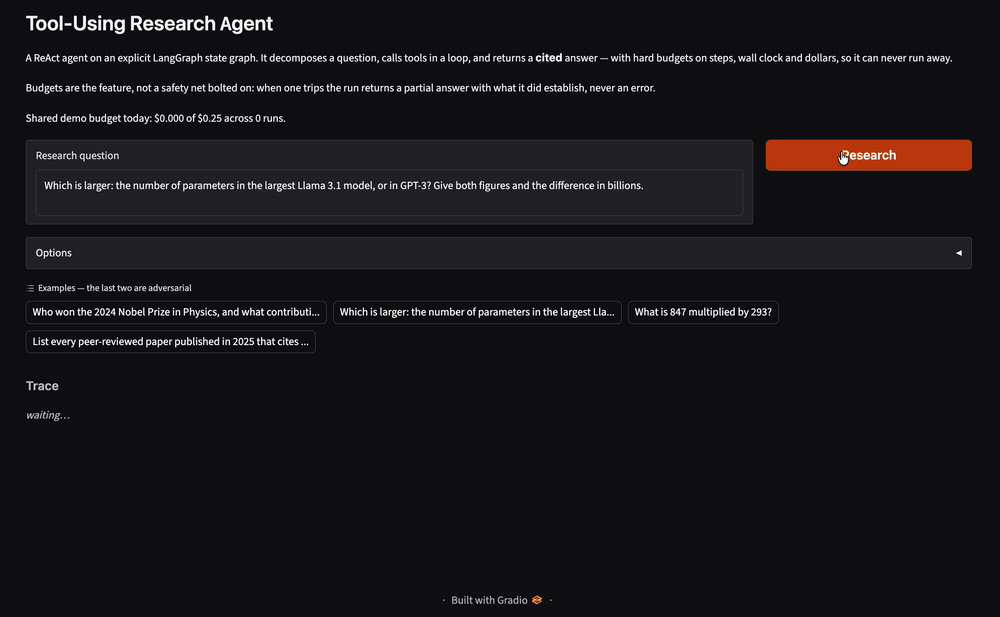
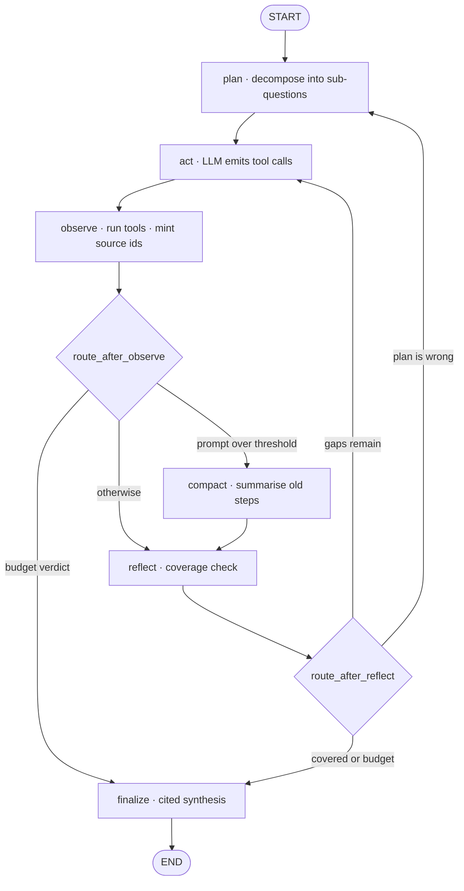

# Tool-Using Research Agent

A ReAct agent on an explicit LangGraph state graph: it decomposes a question, calls tools in a loop,
and returns a **cited** answer — with hard budgets on steps, wall clock and dollars, so it can never
run away.

**[Live demo →](https://vireshk-research-agent.hf.space)** · Hugging Face Space, alongside [production-rag-platform](https://huggingface.co/spaces/vireshk/production-rag-platform) · first load after 48h idle takes ~40s



*Two sub-questions, four parallel searches, a coverage check, the calculator for the arithmetic,
then a cited answer — 405B − 175B = 230B. Real run, unedited apart from being sped up 1.8×.*

Budgets are the feature, not a safety net bolted on afterwards. When one trips, the run returns a
partial answer with whatever it did establish — never an error, never nothing.

---

## Measured results

30 cases × 3 independent runs = **90 trajectories**, agent `gpt-5.4-nano`, judge `gpt-5.6-luna`.
Every per-run trace is committed under [`evals/results/traces/`](evals/results/traces/), so every
number below can be traced back to the run that produced it.

| Metric | Value | 95% CI |
|---|---|---|
| **pass@1** — a single attempt succeeds | **96.7%** | [83–99%] |
| **pass^3** — *all three* attempts succeed | **93.3%** | [79–98%] |
| Tool recall | 100.0% | — |
| Tool precision | 36.8% | see the caveat below |
| Citation resolution (cited ids that exist) | 97.7% | — |
| Invented-URL rate | n/a | no answer contained a URL to check |
| Cost per run | $0.0024 | p95 $0.0042 |
| Latency | 11.4s p50 | 25.7s p95 |

Full breakdown, per-tier results and failure modes: **[evals/REPORT.md](evals/REPORT.md)**.

### The headline finding: the loop's problem was its prompt, not its architecture

The point of an evaluation is to be able to be wrong, and this one has now been wrong about its own
agent — in a way worth keeping on the record, because the correction is the result.

**Pass one.** A `baseline` variant — plan once, issue every search in one parallel round, answer —
beat the full iterative agent on every tier: **94.4% against 87.8%**, three times cheaper. The
conclusion on the evidence then available was that iterative refinement was not merely failing to
pay for itself but actively destructive. Those results and their traces are tagged
[`v0.2.0-pre-gate`](../../releases/tag/v0.2.0-pre-gate).

**What the traces actually said.** The obvious reading is that the loop searches too much, and that
turned out to be false. Only **2 of 305 searches** repeated a query and only 6% of calls returned
nothing new. The waste was elsewhere. `act` emits no tool calls when it believes it can answer, and
**77 of 228 rounds** were that. In 40 of them `reflect` agreed and the run ended — the graph simply
needs one more `act` call after the last search to say so. In the other **37, `reflect` overruled
the stop** and sent the agent round again with nothing to do. Those 35 overrules were spread across
four cases, two of them perfectly answerable: `easy-001` alone was overruled nine times.

Two lines of prompt contradicted what these very runs measured, and both are the kind of defect no
test catches:

- `SYSTEM` said *"prefer several specific searches over one broad one"* and then, four lines later,
  *"do not keep searching to feel thorough."* The first is about the width of one round and now
  says so.
- `REFLECT_SYSTEM` listed its two failure modes *"in order of how common they are"* and put
  **stopping early first**. These very runs measured the opposite. The order is now inverted, the
  measurement is quoted in the prompt, and a proposed stop puts the burden on reflect to name the
  specific missing evidence.

**Pass two, after fixing those two lines and changing nothing else**, the full agent scored **96.7%
pass@1 and 93.3% pass^3**, on the same search engine as pass one. Two caveats travel with that
number: it was measured two and a half months after pass one, so web drift sits inside the
87.8% → 96.7% change alongside the prompt fix; and 30 cases cannot tell it apart from luck to within
roughly ±8 points.

**The pass-two comparison against the baseline is withdrawn.** Tavily's free tier allows 1,000
searches a month, and it ran out partway through the re-run. The full agent used Tavily for all 328
of its searches; the baseline fell back to DuckDuckGo for 80 of its 287, and the `no_overrule`
ablation for all 389. A comparison between them measures two search engines as much as two agent
designs. An earlier version of this README drew conclusions from it — that the loop now beats the
baseline, and that a half-finished investigation scores worst on adversarial questions — and
neither survives. Pass one is unaffected: every variant there used Tavily for 99% or more of its
searches. The comparison that settles the question is the evaluation described under
[What I'd do next](#what-id-do-next), run on a single search engine from end to end.

**What the prompt fix changed in the stop decision — and what it did not.** This one compares the
full agent with itself, on Tavily both times, so it stands. On answerable questions `reflect`
stopped overruling altogether: **14 overrules on easy and multi-hop cases became 0.** On adversarial
cases it did not improve at all — **21 became 26**, and `adv-004` still spins eight rounds in every
run. The pattern is the diagnosis: on a question that cannot be answered, `reflect` can always name a
missing piece, because the missing piece does not exist. What is defensible is narrow: **with the
corrected prompts the stop decision no longer fails on answerable questions, and still fails on
unanswerable ones.**

**Is the judge trustworthy? Not currently demonstrated, and the way that broke is worth
reading.** The judge was validated against 90 hand labels made before any verdict was visible:
**Cohen's κ = 0.824**, raw agreement 96.7%, Gwet's AC1 0.959, with the judge saying CORRECT where
the human said INCORRECT **zero times** — errors only ever in the stricter direction. That result
was real, and it describes the August trajectories, which are preserved at
[`v0.2.0-pre-gate`](../../releases/tag/v0.2.0-pre-gate).

Re-running the evaluation **silently invalidated it**. Labels were keyed by `(case_id, run)` alone,
and those keys are reused by every run, so all 90 labels quietly repointed at answers no human had
ever read. κ "fell" to 0.331 and nothing raised an error — a stale comparison still returns a
perfectly plausible number, which is exactly what makes it dangerous. Labels now carry a hash of
the answer they graded, `evals/REPORT.md` discards any that no longer match and **refuses to report
agreement at all** rather than computing it against the wrong text, and the current figures are
therefore marked unvalidated until a sample is re-labelled.

Every judge-derived number below should be read in that light.

**Caveats, stated rather than buried.** No comparison between variants in this README is currently
established. Pass one's are sound but small — at 11 multi-hop and 7 adversarial cases the per-tier
intervals are very wide — and pass two's are confounded by the search engine. The honest claim today
is narrow: *the loop's original failure traced to two prompt lines, and the stop decision still
fails on unanswerable questions.* Whether the loop beats one round of search is an open question
with a pre-registered test, not a result.

`pass^3` is 93.3% against a pass@1 of 96.7%, and the gap between `pass^3` and `(pass@1)^3` is
**+0.030**. Because x^k is convex, that quantity is non-negative whenever per-case rates differ at
all, so a positive value means failures are **concentrated in a fixed set of cases** rather than
scattered randomly across runs. It has fallen from +0.090 as the overall rate rose, which is what
fixing a systematic defect looks like: the remaining failures are fewer and closer to genuine
run-to-run variance than to a fixed set of cases the agent cannot do.

---

## What it does

1. **plan** — decomposes the question into 1–5 searchable sub-questions.
2. **act** — the model picks tools. Tools that have hit their per-run cap are withdrawn from the
   schema rather than offered and refused.
3. **observe** — runs the calls in a thread pool, mints citable source ids, truncates observations,
   and counts consecutive failures for a circuit breaker.
4. **compact** — folds older steps into a rolling summary when the prompt grows past a threshold.
5. **reflect** — checks coverage against the sub-question list and decides continue / replan / finish.
6. **finalize** — synthesises a cited answer, or assembles one from state without an LLM if the
   budget is gone.

Tools: `web_search` (Tavily, with a circuit-broken `ddgs` fallback), `fetch_page`, `calculator`,
`code_execution` (kernel-contained: seccomp + Landlock), `file_ops` (workspace-confined).

## Architecture



This diagram is generated by `research_agent.graph.mermaid()` from the same constants the graph is
wired from, so it cannot drift out of sync with the code. A test asserts every node appears in it.

### Design decisions

| Concern | Choice | Why |
|---|---|---|
| Graph construction | Hand-built `StateGraph`, not `create_react_agent` | The control flow *is* the artefact. A prebuilt agent hides both the routing and the eval surface. (`create_react_agent` is also deprecated as of LangGraph 1.0.) |
| Recording *why* a run stopped | One pure `budget_verdict(state, cfg)`, called twice | LangGraph's conditional edges are pure routers — they return a node name and cannot write state, so the edge that decides to bail cannot record the reason. The router calls it to route; `finalize` calls it again to write the reason. Being pure, they agree by construction. |
| Running out of money mid-run | A reserve withheld from the loop | A loop that spent to 100% of the cap would leave `finalize` unable to afford its own call and return nothing — the opposite of graceful degradation. |
| Losing citations to compaction | Sources live in state, not in message text | Compaction rewrites the scratchpad; the citation registry is a different key. No summariser mistake can reach it. A test proves this by feeding in a summary that names no sources at all. |
| Message format | Raw OpenAI dicts with `operator.add`, not `add_messages` | `llm.py` speaks the wire format directly, so `add_messages` would coerce dicts into objects that every call converts back. Its one real feature — ID-based dedup — is unused here. |
| Parallel tool calls | A thread pool *inside* `observe` | Parallel graph branches writing the same reducer-less key in one super-step raise `InvalidUpdateError`, and each branch burns a super-step against the recursion limit. |
| Hosting | A free ZeroGPU Space that never uses the GPU | Hugging Face gates cpu-basic Spaces behind PRO; ZeroGPU is the free route once an account is ~30 days old. ZeroGPU refuses to start without a `@spaces.GPU` function, so `app.py` declares one that is never called — the GPU is allocated on *call*, not on decoration, so nothing is reserved. Measured, not read from docs: the first attempt failed with exactly that error. |
| API surface | Responses, not Chat Completions | Measured, not assumed: Chat Completions returns a 400 for `tools` + `reasoning_effort` on both `gpt-5.4-nano` and `-mini`. Responses handles it. |

---

## Evaluation

Most agent repos ship a loop and a screenshot. The eval is the part this project is actually about,
so it is hand-rolled rather than delegated: `agentevals` has had no release in a year, Ragas changed
GitHub orgs and is deprecating its own `ToolCallAccuracy`, and OpenAI's hosted Evals platform shuts
down in November 2026. A few hundred owned lines outlive all three, and the metric definitions stay
legible instead of living behind someone else's `.evaluate()`.

**One rule governs the dataset**, enforced by the loader: every case carries at least one
deterministic anchor — a string that must (or must not) appear in a correct answer. If a correct
answer cannot be pinned that way, the case is unscoreable and the judge ends up measuring its own
taste. Cases that cannot meet that bar are cut.

**Tool-call accuracy** uses maximum bipartite matching between expected and actual calls, not greedy
left-to-right — greedy lets one actual call satisfy two expectations, inflating recall on exactly the
runs where the agent was lazy. Arguments are compared field by field with per-field semantics (seven
matchers: exact, contains_any/all, regex, numeric_close, lte/gte, any), not by serialising both sides
and comparing strings. All three degenerate cases are defined explicitly, because undefined edge
cases are where harnesses quietly return flattering numbers:

| Expected | Actual | P / R / F1 |
|---|---|---|
| 0 | 0 | 1.0 / 1.0 / 1.0 — correctly declined to use a tool |
| 0 | >0 | 0.0 / 1.0 / 0.0 |
| >0 | 0 | 1.0 / 0.0 / 0.0 |

**Ordering** is scored by longest common subsequence rather than Kendall tau, so an agent that got
the spine right and inserted an extra hop gets partial credit; Kendall penalises every inversion
equally and cannot tell those apart. **Forbidden-tool calls are reported separately from F1** — waste
and safety are not capability. **Citation resolution** is the cheapest hallucination check here and
the only one that catches a confident answer citing a source that does not exist. **Invented-URL
rate** exists for the same reason but has had almost nothing to measure: the agent cites source ids
rather than pasting URLs, and across 180 committed runs exactly one answer contained a URL. It is
reported as n/a rather than as a 0% it never earned.

**The judge** is binary with an anchored rubric and four worked examples, and every committed
evaluation ran it at one sample per trajectory. It is validated against hand labels rather than
against itself — agreement with a human is the evidence that matters, and self-consistency would
not have caught a judge that is confidently and consistently wrong. Those labels now record a hash
of the answer they graded, so a re-run can never silently repoint them again. Unparseable judgements are
excluded and counted, never coerced to INCORRECT, since coercion biases the result in whichever
direction it goes.

Every rate carries a **95% Wilson interval**. At n=30 the normal approximation runs outside [0,1] and
is simply wrong, and a rate without an interval at this sample size is the first thing worth
questioning.

`make report` regenerates [evals/REPORT.md](evals/REPORT.md) from the committed results, and CI runs
it followed by `git diff --exit-code` — which proves mechanically that every number here comes from a
committed artefact rather than from something typed once by hand.

---

## Quickstart

```bash
git clone https://github.com/vireshkoli/Research-Agent-Langgraph.git
cd Research-Agent-Langgraph

uv sync --dev
cp .env.example .env          # add OPENAI_API_KEY; TAVILY_API_KEY is optional
uv run pre-commit install     # optional: ruff + gitleaks before each commit
make check                    # ruff + mypy + 272 tests, no API key needed

uv run python -m research_agent "Who won the 2024 Nobel Prize in Physics, and why?"
```

Watch a budget trip and still get an answer:

```bash
uv run python -m research_agent --max-steps 1 \
  "Which is larger: the largest Llama 3.1 model or GPT-3? Give both figures and the difference."
# → partial cited answer, early_exit_reason: max_steps, exit code 0
```

Other entry points:

```bash
make eval-dry                 # validates all 30 eval cases, spends $0
make report                   # regenerates evals/REPORT.md from committed results
docker compose up demo        # the same app in the local container, on localhost:7860
make deploy-hf                # push to the Hugging Face Space (needs HF_TOKEN)
uv run python -m research_agent.tools --demo   # exercise every tool once
```

---

## Known limitations

Written before anyone asks.

- **Whether the loop beats one round of search is not established.** Pass one said it did not, at
  n=30 with wide intervals. Pass two cannot say anything either way, because its variants ran on
  different search engines. The baseline is 3× cheaper in every pass.
- **A search quota can silently change what an evaluation measures.** When Tavily's monthly free
  tier ran out mid-sweep, the agent fell back to DuckDuckGo exactly as designed for a live demo —
  and for an evaluation that fallback is a confound, because later variants then ran on a different
  search engine from earlier ones. Nothing failed and every number looked plausible. Found by
  counting search credits against search calls in the committed traces.
- **The stop decision still fails on unanswerable questions.** 27 of 210 rounds are the agent
  proposing to stop and `reflect` overruling it, every one of them on the adversarial tier; `adv-004`
  spins eight rounds in every run. A further 46 rounds exist only to let `act` say it is finished
  after its last search — a structural cost of the topology rather than a misjudgement. Neither is a
  reason to remove `reflect`: the ablation that does so loses accuracy, through a mechanism the
  ablation cannot isolate.
- **The headline reversed once, and could again.** This evaluation concluded the opposite in its
  first pass; between the two passes the prompts changed *and* two and a half months passed. An n=30 benchmark that flips on a
  prompt edit should be treated as a diagnostic instrument, not a leaderboard.
- **Tool precision understates the agent.** The 36.8% is matched/n_actual against
  `expected_tools`, which names at most one call for 81 of 90 runs while the agent is designed to
  fan out several parallel searches per round. A correct four-way fan-out against a one-call
  expectation scores 25% with nothing wasted. The number is a lower bound confounded with the
  dataset's own thinness, and `evals/REPORT.md` now measures redundancy directly instead of
  inferring it from precision. The order score is likewise computed on only the 3 runs that declare
  a `tool_order`.
- **The before/after across the prompt fix is confounded.** 87.8% was measured in August and 96.7%
  today, so web drift sits inside that gap alongside the prompt change. The four-way comparison
  between variants was run back to back against one prompt set and is sound; the across-time
  comparison is indicative only.
- **Judge costs were under-recorded and are now corrected.** Judge calls were priced at the 50%
  Batch rate while being issued synchronously, which halved every published judge figure. The
  committed results carry the corrected numbers, the discount is gone from the code, and the
  totals here reflect the real spend.
- **The judge is currently unvalidated against the committed answers.** κ = 0.824 (bootstrap CI
  [0.580, 1.000], Gwet's AC1 0.959) was measured against the August trajectories and still stands
  for those; re-running the evaluation invalidated all 90 labels, and the report now refuses to
  report agreement rather than compute it against answers no human read. Re-labelling a sample
  restores it. The interval was wide even when valid — "almost perfect" at the point estimate,
  only "moderate" at the lower bound, because κ is unstable when one label dominates the marginals.
- **Self-preference is not controlled.** Judge and agent are both OpenAI models. They are different
  *generations*, not different *families*; ruling this out needs a judge from another provider.
- **n=30 is small.** Every interval above is wide. Differences under ~15 points are not
  distinguishable from noise.
- **Prompt caching engages late, and the reason is 1,024 tokens.** Measured across the 90 current
  `full` runs, 11.4% of input tokens were served from cache — and 0% of the first `act` call, 1.2% of
  the second, 60.7% of the third onward. OpenAI only caches a prefix once it reaches 1,024 tokens,
  and the first `act` call is 891 on average, so it is never written to the cache and the second
  call finds almost nothing to reuse despite beginning with the same text. Most runs stop after two
  calls, which is why the overall rate is low; longer FRAMES runs reach 34% for the same reason. An
  earlier version of this README blamed a ~270-token system prompt, which left out the tool
  definitions that make up most of the prefix, and quoted an older 6.6%. The stable prefix sits just
  under the threshold, so lengthening it with useful content is expected to save roughly 6% a run —
  measured, not assumed, once that change lands.
- **`code_execution` is contained by the kernel, and only the kernel layers are claimed.** The model
  writes this code after reading pages anyone can write, so it is treated as hostile. An audit found
  six escapes from the earlier in-process sandbox (`uuid.os.popen`, `__builtins__['__import__']`,
  string-built dunders, reading `.env`, `__loader__.load_module`, `typing.get_type_hints`), and an
  in-process Python sandbox cannot be made sound. What can be is what the process may ask the kernel
  for, without privileges: **seccomp-bpf** refuses sockets, exec, signalling or tracing other
  processes, and every file write; **Landlock** confines reads to the stdlib and a scratch
  directory, which keeps every `/proc/*/environ` — so every API key — out of reach. Both **fail
  closed**: on a Linux host that cannot apply them, the code does not run. Tested by running
  *unrestricted* Python under the real filters on Linux CI, and confirmed on the live Space, where the
  tool only succeeds if both layers applied. The in-process restrictions still close all six known
  escapes, but are defence in depth and not claimed as a boundary. On macOS neither kernel layer
  exists; each result's `meta["isolation"]` says which layers ran.
- **Two security limitations remain, stated rather than implied away.** `fetch_page` checks the
  *resolved* address of every request and redirect hop, but httpx resolves again when it connects, so
  DNS rebinding is not stopped. And the demo's per-session spend cap is keyed on Gradio's session
  hash, which a page refresh resets; the daily cap is the control that actually holds.
- **Two of my own eval cases were wrong**, and both were caught before publication. One scored a
  correct refusal as a failure because a substring anchor cannot distinguish quoting a prompt-injection
  payload from obeying it. The other asked how long before the Web went public *Snow Crash* was
  released, marking the agent wrong for answering 1993 (CERN's public-domain release) against a
  reference asserting 1991 — both defensible. That case was rewritten and re-run rather than having
  its rubric loosened after the fact; the substitution is recorded in `evals/results/full.json`.
- **The Space depends on a ZeroGPU quirk.** It runs free only because ZeroGPU accepts a declared-but-never-called `@spaces.GPU` function. If Hugging Face tightens that check the demo goes dark; the Dockerfile and `docker compose up demo` are the fallback, and the GIF above is the proof-of-life that survives either way.
- **Re-running produces different numbers.** The agent is non-deterministic and the web moves under
  it. The committed traces are the evidence, not a reproducibility promise.

## What I'd do next

1. **Settle full against baseline with a test sized to the question.** A paired comparison on harder,
   multi-hop questions than the 30 here, with enough of them that a real difference cannot be
   mistaken for luck — sized by a power calculation rather than picked — run on one search engine
   from end to end, with the hypothesis, the test and the decision rule committed before any run.
2. **Re-run every variant on the same day, on the same search engine.** That is the only way to
   separate the prompt fix from web drift and from the search backend.
3. **A larger labelled sample.** 90 items puts κ's lower bound at 0.580; a few hundred would
   tighten it enough to distinguish "almost perfect" from "moderate".
4. **A cross-family judge** (Claude or Gemini) to bound self-preference rather than disclaiming it.
5. **Grow the dataset to ~100 cases.** The interval width at n=30 is the binding constraint on saying
   anything is better than anything else.
6. **Make search results cheaper to read.** A rerank-and-truncate pass over search snippets before
   they enter the prompt would cut input tokens materially at these step counts.

---

## Repository layout

```
src/research_agent/
  llm.py         the single OpenAI wrapper: pricing, cost tracking, four spend guards
  graph.py       StateGraph wiring, both routers, the mermaid diagram
  budget.py      budget_verdict() — the pure function the routers and finalize share
  state.py       ResearchState + the reducers, each with its reasoning
  nodes/         plan, act, observe, compact, reflect, finalize
  tools/         registry + web_search, fetch_page, calculator, code_exec, file_ops
  trace.py       the canonical per-run trace schema
  demo_guard.py  daily spend cap, BYO-key, input limits for the public demo
evals/
  dataset.json   30 cases: 12 easy, 11 multi-hop, 7 adversarial
  metrics.py     bipartite matching, P/R/F1, LCS ordering, pass@1 / pass^k, Wilson CIs
  judge.py       binary rubric with worked examples
  agreement.py   Cohen's κ, Gwet's AC1, bootstrap CI, confusion matrix
  results/       committed traces and results — the audit trail behind every number
tests/           272 tests, no API key required
```

## Licence

MIT — see [LICENSE](LICENSE).
